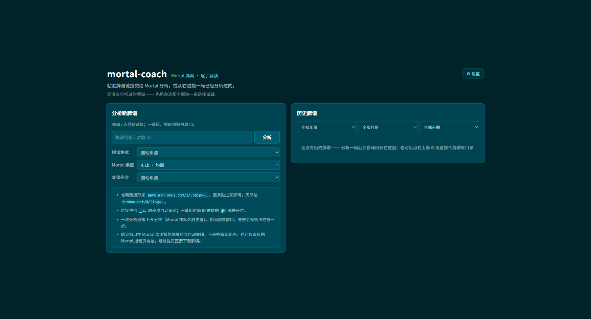
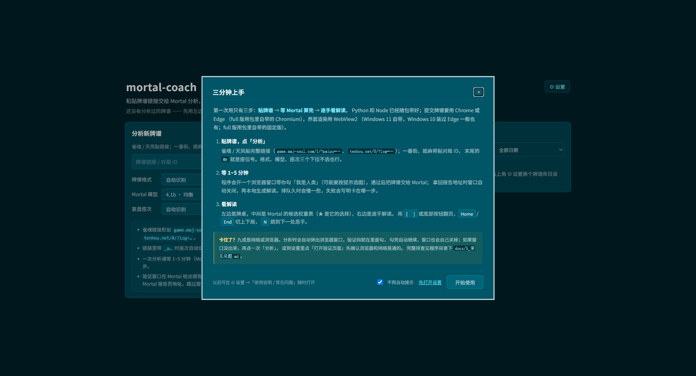
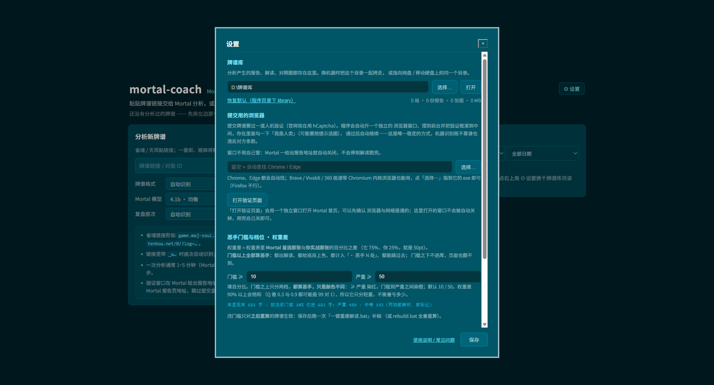

# mortal-coach · 日麻 Mortal 牌桌复盘

一个双击就能用的本地复盘 App：**左边牌桌、右边中文解读**，粘贴牌谱现场分析。
判定引擎是 [Mortal](https://mjai.ekyu.moe/)（4.1b / 4.1c / 4.1a / 4.0 / 3.0 五档可选），
解读与配图**全部本机计算**，不调用大模型，也不需要 API Key。新牌谱的 Mortal 在线评分仍需联网。

界面全中文，支持 **Windows 10 / 11 x64**。解压完整文件夹后双击 `mortal-coach.exe` 就能用，
无需安装 Python / Node。应用会自动使用系统已有的 **Chrome 或 Edge** 提交牌谱、用系统
**WebView2** 渲染界面；两者缺失时会给出中文提示和安装 / 配置入口。新牌谱评分需要联网，
已有本地报告可离线复盘。



---

## 立即下载与上手

从 [最新 Releases](https://github.com/Guedouse/mortal-coach/releases/latest) 下载 **windows-x64-lite.zip**；系统缺少 WebView2 时可以选 **full.zip**。两个包都需要已安装的 Chrome 或 Edge，均已附带 Python 和 Node。不要下载 GitHub 自动生成的 **Source code** 来双击运行。

1. 使用 Windows「全部提取」完整解压到本地可写目录，双击 `mortal-coach.exe`，不要只复制 EXE。
2. 将游戏里的完整牌谱分享文本贴入首页，按需要选择模型和座次，点击「分析」。
3. 自动评分完成后，会进入牌桌并显示中文解读，无需复制报告地址或安装扩展。
4. 若弹窗要求人机验证，在浏览器窗口里勾选「我是人类」并完成提示的选图，通过后自动继续；Mortal 一给出报告，窗口会自动关闭。

下载校验、升级备份、首次验证和排错详见 [使用说明](使用说明.md)。问题反馈请到 [Issues](https://github.com/Guedouse/mortal-coach/issues)，只提供脱敏日志，不要上传个人牌谱库或浏览器资料。

发行包从空库启动，不附带作者的配置、牌谱、日志、浏览器 Cookie 或机器标识；文档截图仅展示空白首页、引导和通用设置；隐私行为见 [数据与隐私](PRIVACY.md)。输入新牌谱时会把链接提交给 Mortal 社区服务。

## 特性

- **粘链接就分析**：雀魂 / 天凤贴链接；一番街、姬麻将贴对局 ID；也可以直接贴 Mortal 报告页。
- **逐手中文解读**：为什么打这张、进张差多少、打点走哪条线、这一手该攻还是该守。
- **Mortal 权重表**：常驻在牌桌与解读之间，列候选牌、softmax 权重、Q 值，标出 Mortal 的最优解和你实际那一手。
- **全篇看图说话**：手牌、有效牌、改良牌、正文里提到的每一张牌都用真实牌面 SVG，
  文字里不出现「2万」这种写法。牌效页并排画两手 13 张（按面子 / 搭子 / 浮牌分组），
  **全部有效牌**连剩余枚数一起铺开，不再用「+N」省略；改良牌单独一张卡左右对照。
- **决定性要素置顶**：每手的主判据做成金色高亮条（★ + 左侧色条），论据缩进弱一档，
  一眼能看出这一手到底在比什么。
- **打点会明说**：宝牌、断幺、役牌之外，还有一层通用番数对比——把「打这张 vs 打那张」
  的主线役与成型点数各算一遍，差几番直接写出来（混一色、七对子、一气、三色、一杯口都覆盖）。
- **首次使用引导**：第一次打开弹一次「三分钟上手」，底部可勾「不再自动提示」，设置里随时能重开；
  报错按「阶段名」给可操作提示，详细排查见 [常见问题](docs/5_常见问题.md)。
- **恶手门槛可调**：入库门槛（默认权重差 10%）与严重线（默认 50%）都在设置里改，
  门槛之上全部算恶手、只按权重差分红 / 橙两种颜色；面板右上角的徽章另按「期望损失 Q」
  标这一手亏得多不多，两套刻度互不影响。
- **提交进度与重试**：显示验证、提交、评分与下载阶段；对可重试错误最多重试 3 轮，其他错误给出处理说明。
- **不打扰**：提交用的浏览器窗口挪到屏幕外，跑完走 CDP 正常关闭，不会弹「Chrome 未正常关闭」。
- **数据在你手里**：牌谱库目录可配置，默认在程序目录下 `library/`，可指向网盘或移动硬盘。

---

## 下载与运行

### 方式一：发行包（推荐）

两种资产的区别仅为是否附带界面运行时 WebView2。**默认下载 lite**；两种版本分析新牌谱都需要用户安装 Chrome 或 Edge。

| 文件 | 适合谁 |
|---|---|
| `mortal-coach-<版本>-windows-x64-lite.zip` | 系统已有 Chrome／Edge 和 WebView2，优先选择 |
| `mortal-coach-<版本>-windows-x64-full.zip` | 需要随包 WebView2 界面运行时；提交浏览器仍由用户安装 |

包的实际大小以 Releases 文件和清单为准。两种版本均不附 Chromium，也不会自动下载安装浏览器。

1. 解压到**有写权限**的目录（页面上单独列出的 `SHA256SUMS.txt` 用来校验下载是否完整）。
2. 双击 `mortal-coach.exe`（不要只拷 EXE 出来，`assets/`、`scripts/`、`tools/`、`runtime/` 要一起）。
3. 首次启动会在程序目录下建空的 `library/`，之后分析记录都存在那里。

**两个包差在哪**：lite 使用系统 WebView2；full 附带 WebView2 Fixed Version 152.0.4191.53。
新牌谱默认使用系统已装的 Chrome／Edge，保留自动填写、提交、取回报告和中文解读。浏览器使用本应用独立资料目录，需要真人验证时请在窗口内完成，不需要安装扩展或复制报告地址。
WebView2 仅用于应用界面，不承担向 Mortal 提交牌谱。
full 不往系统里装任何东西、不写注册表、不要管理员权限。**卸载**：关掉应用、备份要留的牌谱，
删掉程序目录即可；如果你把牌谱库改到了别的目录，或换过配置，`%LOCALAPPDATA%\mortal-coach\`
下还会留实例缓存（配置、WebView2 数据），这两处需要自己按实际路径清理。Windows 10 上首次
启动会给包内 WebView2 目录补两个 AppContainer 读执行权限（见下文），这属于目录 ACL，
删目录即随之消失。

运行环境要求（**这是本发行版的真实边界**）：

- Windows 10 / 11 **64 位**。macOS、Linux、32 位 Windows、ARM64 不能直接运行这个包。
- 已带 Python 3.13 与 Node 22，**不需要另外安装**。
- 两种版本分析新牌谱都需要系统里有 **Chrome 或 Edge**（只装了 Edge 也可以，会自动找到它）—— 提交新牌谱
  要过一个真人验证，必须用真浏览器。找不到时分析请求会直接告诉你原因，并指到
  「设置 → 提交浏览器」手动指定 exe 或安装浏览器。full 版同样需要用户安装浏览器。
- 界面渲染用 WebView2。lite 版用系统那份：Windows 11 自带，Windows 10 只要装过
  Microsoft Edge 一般也有；**应用启动时会自己检测**，认不到就弹一个说明框并给出微软官方
  下载地址（约 2 MB，装完重启应用即可），退出码 2，不会让你对着一句异常发呆。
  **full 版自带固定版运行时，不依赖系统。**
  `mortal-coach.exe --selftest` 会打印 `chrome_source` / `webview2_source`
  （浏览器为系统路径，WebView2 为 `system` 或 `bundled`）/ `webview2_version` 自查。

> full 比 lite 大，主要因为附带完整 WebView2 界面运行时，不能随意裁剪其文件。

**联网边界**：打开已有报告、重新生成中文解释，全程离线可用；**输入新牌谱链接必须联网**
（评分在 `mjai.ekyu.moe` 上做，本包不含 Mortal 推理引擎与模型权重）。

### Windows 10 上的 full 版（目录权限）

微软从 WebView2 Fixed Version 120 起，要求 Windows 10 上的未打包 Win32 应用给运行时目录
授予两个 AppContainer SID 的读/执行权限，否则界面进程起不来。普通 ZIP 解压不会带这两个
权限，所以程序在 **Windows 10 上首次启动时会自己检查并补授**：

```bat
icacls "runtime\webview2\152.0.4191.53" /grant *S-1-15-2-2:(OI)(CI)(RX)
icacls "runtime\webview2\152.0.4191.53" /grant *S-1-15-2-1:(OI)(CI)(RX)
```

- 解压在桌面、文档这类自己有写权限的位置：自动补授，静默通过。
- 解压到 `Program Files` 等受保护位置：补授失败，程序会**改用系统 WebView2**（装过 Edge
  一般就有）；系统也没有时弹中文说明，给出上面两条命令让你用管理员执行一次。
- Windows 11 不受该限制，不做任何改动。

`mortal-coach.exe --selftest` 新增三个字段可核对：`windows_build`、`webview2_acl`
（`not-needed` / `ok` / `missing` / `unknown`）、`webview2_acl_note`。在 Win10 上看到
`missing` 且有系统运行时，程序仍能启动，只是用的是系统那份而不是包内那份。

另外，Fixed Version **不能从网络位置或 UNC 路径运行**：程序本体请解压到本地磁盘
（牌谱库放网络盘是另一回事，不受这条限制）。

### 方式二：源码运行

```bash
git clone https://github.com/Guedouse/mortal-coach.git
cd mortal-coach
pip install -r requirements.txt        # pywebview + Pillow
python app/main.py                     # 需要 Python 3.10+ 与 Node 22+
```

> 用到 `fetch` / `WebSocket`（提交脚本），Node 必须是 22 或更新版本。

源码模式不会自动带 `runtime/`，`--selftest` 会把缺的东西列出来（缺项时退出码非 0）：

```bat
python app\main.py --selftest
```

### 自己打一个发行包

仓库**不**把 `runtime/`、EXE、整份浏览器放进 Git；它们只作为 Release 资产。要从源码出包：

```bat
:: 1) 打 EXE（需要 pip 装好 pywebview / Pillow / pyinstaller）
cd app
pyinstaller mortal-coach.spec --distpath .. --workpath ..\build --clean --noconfirm
cd ..

:: 2) 白名单打包 + 验包（自动排除个人牌谱、写 SHA256SUMS 与 release-manifest.json）
runtime\python\python.exe build_release.py --out D:\dist                    :: 默认 lite

:: 想用人类可读的版本号（默认是 日期-提交）：文件名、manifest、校验文件都由它生成
runtime\python\python.exe build_release.py --out D:\dist --version v1.0

:: full 版仅附 WebView2 界面运行时，不附提交浏览器
::   runtime\webview2\<版本>\msedgewebview2.exe ← 官方 Fixed Version cab 解压（expand 即可）
runtime\python\python.exe build_release.py --out D:\dist --flavor full --version v1.0
```

`build_release.py` 只从 `REQUIRED_FILES` + `INCLUDE_DIRS` 枚举文件，**不会**直接压开发目录；
打完再重新打开最终 ZIP 扫一遍禁入项、本机路径、BAT 行尾与配置，命中就失败。
**不要手工重命名 ZIP** —— 校验文件与 manifest 里写的是原名，改名后自动化核验第一步就找不到文件；
要换名字请用 `--version` 重新打包。产物：

- `mortal-coach-<版本>-windows-x64-lite.zip` / `-full.zip`
- `SHA256SUMS.txt`（两个包的哈希都写在一起）、`release-manifest.json`（最近一次构建）、
  `release-manifest-<flavor>.json`（按 flavor 各存一份，先打 lite 再打 full 也不会互相覆盖）

`--flavor` 也决定验包口径：lite **不许**夹带 `runtime/chromium`、`runtime/webview2`；
两种版本都**不许**带提交用 Chromium；full **必须**有 `msedgewebview2.exe`、`msedge.dll`，并且文件数量够（断点续传
只解了一半的目录会被当场判失败，不会打出个空壳包）。

> `runtime/python`、`runtime/node` 需要自己准备（官方 Python 3.13 embeddable + Pillow、
> Node 22 x64）；`build_release.py` 缺它们会直接报错退出。

---

## 第一次使用：设置牌谱库

首次启动会弹一次「三分钟上手」（贴牌谱 → 等 → 看解读），底部默认勾着「不再自动提示」，
关掉后就不再弹；之后可在 **⚙ 设置 → 使用说明 / 常见问题** 再打开。
完整教程见 [docs/4_使用说明与设置教程.md](docs/4_使用说明与设置教程.md)。



主页右上角 **⚙ 设置**：



| 设置项 | 说明 |
|---|---|
| 牌谱库目录 | 报告、解读、对照图、日志都放这里。默认 `<程序目录>/library`，可改成任意可写目录（网盘、移动硬盘都行）。换机器时连同这个目录一起拷走，「历史牌谱」就还在。 |
| 提交用的浏览器 | 留空 = 自动找 Chrome / Edge。也可以手动指定 `chrome.exe`、`msedge.exe`，或任何 Chromium 内核浏览器（Brave / Vivaldi / 360 极速…）；Firefox 用的是另一套调试协议，不行。验证窗口由程序自动弹出，不需要手动打开；Mortal 给出报告地址后自动关闭。 |
| 恶手分级 | 拆成两段：**巡目标记 · 权重差**（默认严重 ≥ 50%、中等 ≥ 10%，只有巡目上色、计数、跳转用它）+ **损失程度 · 期望损失 Q**（默认 ≥ 0.70 / ≥ 0.30，只看解读面板右上角的徽章）。 |
| 高级：运行时路径 | 只有想把 Python / Node 换成系统安装版时才需要改。 |

> 程序目录只读（例如装在 `Program Files`、只读共享盘）时：配置改写
> `%LOCALAPPDATA%\mortal-coach\instances\<本副本标识>\config.json`，牌谱库默认也落在这个
> 实例目录下的 `library/`（设置里会显示真实路径）。两份解压副本各用各的目录，互不覆盖；
> **应用不会去读 `%APPDATA%\mortal-coach\` 下的旧全局配置**，要搬旧库请在设置里主动选目录。
>
> 同一个牌谱库被两个副本同时打开时，后启动的那个会拿到「只读」提示：可以浏览，
> 但分析和删除会被拒绝，避免两边同时写 `bad_moves.json` 互相覆盖
> （占用标记是库目录下的 `.mc-lock`，进程退出自动释放）。
> 在设置里**切换到**一个正被占用的库也会被拒绝，并且不会改动配置文件；
> 命令行重建（两个 BAT / `rebuild_all.py`）遇到被占用的库会直接退出码 3，一个文件都不写。
> 库目录在只读介质上、锁文件建不出来时同样按只读处理 —— 确认不了有没有别人在写，就宁可不动。
>
> **谁会写库**（都过同一把锁）：界面分析 / 删除、`pipeline_one.py`、`mk_coach.py`、
> `rebuild_all.py`、`refresh_text.py`、`mk_layout.py`（独立命令行入口；正常流水线走它的
> `build()`，库锁由上游持有）。界面派生的子进程靠 `MC_LIB_LOCK_OWNER` 继承授权
> （只认直接父进程），所以分析不会把自己锁死。`tools/submit_auto.mjs` 只往 stdout 输出、
> 不碰库，日志由 Python 侧写。
>
> 界面里**分析、删除一局、保存设置（含切库）共用同一把互斥锁**：pywebview 的 API 请求是并发的，
> 以前删除只拿自己的锁、设置只看「是否在分析」，于是删除进行到一半切库，前半段删 A 库、
> 后半段写 B 库。现在任何一方在跑，另一方都会被明确拒绝并提示稍后重试。

---

## 目录结构

程序与数据是分开的 —— 这样升级程序不会动你的牌谱，换机器也只需要拷 `library/`。

```
mortal-coach\
├─ mortal-coach.exe          双击启动（onefile，约 16 MB）
├─ mortal-coach.json         设置（首次保存后生成；也可不存在）
├─ 一键重建解读.bat          补齐缺解读 / 失败 / 版本过期的局
├─ rebuild.bat               全部重算（约 16~33 秒/局）
├─ runtime\                  随包运行时（发行包才有）
│   ├─ python\python.exe     Python 3.13 + Pillow
│   └─ node\node.exe         Node 22（提交 Mortal 用）
├─ app\                      桌面壳
│   ├─ main.py               窗口 / 静态服务 / js_api / 设置
│   ├─ make_icon.py          画「發」牌图标
│   └─ mortal-coach.spec     PyInstaller 打包配置
├─ scripts\                  牌理与成文（纯标准库 + Pillow）
│   ├─ pipeline_one.py       ★ 一份 report → 解读 + 图 + 查表数据 + 状态文件
│   ├─ extract_core.py       恶手筛选与坐标映射
│   ├─ explain.py            14 类中文模板 + 分步切页 + 教训表
│   ├─ mjcalc.py             向听 / 进张（位运算）
│   ├─ mjeval.py             安全度分级（现物 / 筋 / 壁）
│   ├─ mk_layout.py          600×334 牌型对照图
│   ├─ mk_coach.py           导出前端查表数据 + 局列表 + 权重
│   └─ rebuild_all.py        批量补齐
├─ assets\
│   └─ kd\                   回放器（index.html/js/css）+ 牌图 + 图标
├─ library\                  ★ 牌谱库（可改到别处）
│   ├─ report\               Mortal 原始报告 json
│   ├─ coach\                逐手解读 + 局列表
│   ├─ img_layout\           对照图
│   ├─ logs\                 每次提交的完整日志
│   ├─ work\                 单局中间产物
│   ├─ bad_moves.json        恶手库（含正文）
│   （chrome-profile 不在这里：放在本副本的实例目录，见下文）
├─ tools\                    提交脚本与单测
├─ tests\                    Python 单测
└─ docs\                     设计说明与踩坑记录
```

---

## 怎么用

应用是**两套界面**：主页负责「选牌谱 / 粘链接」，分析页只管看牌。

- **主页**：左边粘贴牌谱、选格式 / 模型 / 座次；右边按年 → 月 → 日三级筛选历史
  （下拉里只列真的有牌谱的年月日，选完年就选不到没有牌谱的月份），点一行就打开。
  每行日期后面跟着这局的**最终顺位**（`1位`～`4位`，金 / 银 / 铜 / 灰），鼠标停上去看最终点数。
- **分析页**：左侧牌桌，中间评分与局 / 巡跳转，右侧逐手解读。左上角 **‹ 返回牌谱选择** 回主页。

快捷键：`[` `]` 翻解读页，`Home` / `End` 上一局 / 下一局。

### 解读里有什么

每一手按「一页一个思考点」分页：

```
局面 → 攻防 → ①关键点 → … → 结论
```

- **局面**：场况、点数、顺位、手牌形状、做牌方向（已听牌时不写——牌型固定了再谈「走哪条线」是硬编）。
- **攻防**（有人立直 / 副露时才有）：威胁、本钱、退路、这一张的风险。
- **关键点**：牌效 / 打点 / 安全，带具体进张数与牌名。

**Mortal 的候选表**常驻在牌桌与解读之间的中间栏，不占解读分页：牌名、权重条、
百分比、Q 值一字排开，★ 是 Mortal 的最优解，`·你` 是实战打的那张。翻页时它跟着当前这一手走，
随时都能对照。

> 权重 = `softmax(Q / τ)`，τ = 0.1。Q 差 0.17 时两个候选的权重比是
> `exp(0.17 / 0.1) = e^1.7 ≈ 5.5` 倍（约 84.6% : 15.4%）——这个温度下分布很尖，
> 不会出现「49% : 42%」那种接近的分布。权重只表示模型当时的选择倾向，**不是和了率或胜率**。
>
> Q 值是模型内部的评价尺度，**没有点棒单位**。Q 差和解读面板右上角的「损失」只用于
> 在同一份报告里排轻重，不能换算成输赢点数或胜率变化。

---

## 牌理口径

解读只讲 **Mortal 的最优解**，不复述手牌、不指责实战。口径以《统计学麻雀战术》
《牌效率》《铳率原理》为主，四条硬修正：

1. 先制愚形原则上即立直；
2. 筋只用于排序，不换算成具体铳率；
3. 壁只挡掉一组两面，挡不住嵌张 / 边张 / 单骑 / 双碰；
4. 间四间 / 里筋不作为论据。

安全度分级（越高越安全）：现物 100 ＞ 绝张字牌 98 ＞ 现二 / 一字牌 96 / 86
＞ 两筋 456 · 筋 19 86 ＞ 生牌字牌 · 筋 28 65 · 筋 37 62 ＞ 456 筋 55
＞ 无筋幺九 44 ＞ 无筋 2·8 40 ＞ 无筋 3·7 37 ＞ 无筋中张 9。

> Mortal 是「这一巡最优」，不是全局最优。解读里的「为什么不弃和」会如实说明这一点。

---

## 常见问题

第一次用先看 **[使用说明与设置教程](docs/4_使用说明与设置教程.md)**（五分钟上手 + 设置详解 + 界面导览）。
遇到报错查 **[常见问题 Q&A](docs/5_常见问题.md)**，按「失败的阶段名」逐条给了原因和处理办法。

| 现象 | 原因 / 处理 |
|---|---|
| 「Mortal 拒绝了这个牌谱」 | 多半是 Mortal 服务端抓牌谱偶发失败。对可重试错误最多重试 3 轮；请先看具体报错，再决定是否重试。日志里有真正提交的地址。 |
| 第一次用就要求过人机验证 | 应用用的是**独立**浏览器资料目录，不继承日常 Chrome 的验证状态。请在打开的浏览器里完成验证；会话会保留，但不能保证以后不再要求验证。 |
| 验证窗口没弹出来 | 程序会在提交前自动把浏览器窗口摆到前台。没出现时先点一次「显示验证窗口」；还是没有，就到设置里点「打开验证页面」确认浏览器与网络通不通。 |
| 验证一直过不去 | 可点「重新加载验证」在同一个窗口里重来。仍然失败时，用自己日常的浏览器打开 `https://mjai.ekyu.moe/` 生成报告，再把最终报告页完整地址（通常含 `?data=...`）贴回应用点「分析」，直接下载报告并生成中文解读。不要贴排队页地址。 |
| 换到另一台机器后「人机验证没拿到 token」 | 官网现在用 hCaptcha，必须由人在窗口里勾选（可能要按提示选图），脚本不会代点。窗口没出来就点「显示验证窗口」；超时也不会关窗，可以点「继续等待」。旧机器带过来的实例目录 `chrome-profile` 会自动作废重建（Chrome 的 cookie 换机器解不开）。 |
| 「下载报告失败：WinError 10061 连接被拒绝」 | 提交完成了，但下载报告那一步连不上。可能是本机（或继承来的环境变量）里 `HTTP(S)_PROXY` 指向一个没人监听的端口，也可能是目标站点、中间网络或安全软件拦了连接。程序会自动改直连重试一次；还不行就看错误里打印的代理与目标地址，逐项排查。 |
| 分析时弹出一个浏览器窗口 | 那是验证窗口，勾完「我是人类」后自动继续；Mortal 给出报告地址后它自己关掉，不用手动关。 |
| 提示「Chrome 未正常关闭」 | 旧版本强制结束进程会这样。现在改为 CDP 正常关闭，并在启动前修复 profile 标记；若仍出现，删掉实例目录里的 `chrome-profile` 重试。 |
| 历史是空的 | 看一下设置里的牌谱库目录是不是指向了别处；也可以点「打开」直接看目录里有没有 `coach/index.json`。 |
| 分析完没有解读 | 这一局可能没有超过 10pt 的恶手（正常结果），状态文件里是 `ok + no_bad_moves`。 |
| 中间栏权重表是空的 | 这一巡不是你的决策点、或这一局是旧流水线生成的（跑 `一键重建解读.bat` 补上）。 |

---

## 自测

```bat
runtime\python\python.exe tests\test_urls.py           :: 地址解析 / 报告校验 / 标签 / 座位
runtime\node\node.exe tools\test_rules.mjs             :: 报告页 URL 规则
runtime\python\python.exe scripts\rebuild_all.py --no-img   :: 一致性检查
mortal-coach.exe --selftest                            :: 运行时 / 浏览器 / 目录自检
```

---

## 隐私

- 牌谱只提交给 `mjai.ekyu.moe`（Mortal 服务）用于评分；中文解读在本机生成。
- 所有分析记录只写在你的牌谱库里，没有账号、没有遥测、没有云端同步。
- 提交用的浏览器使用应用自己的 profile（本副本实例目录下的 `chrome-profile`），走应用自己启动的实例和自己的调试端口，
  不读取、也不接管你日常浏览器的标签。
- **发行包不含任何人的历史数据**：`library/` 是空库（`coach/index.json=[]`、`bad_moves.json=[]`）。

## 许可

本项目以 **MIT** 发布，见 [LICENSE](LICENSE)。

随包分发的第三方组件（Python、Pillow、Node.js、WebView2、i18next、pywebview、牌图）的来源与许可
逐项列在 **[THIRD_PARTY_NOTICES.md](THIRD_PARTY_NOTICES.md)**，许可原文在 `licenses/`。

牌理计算（`assets/kd/shanten.js`、`assets/kd/efficiency.js`）是本项目自有实现，与
`scripts/mjcalc.py` 同源，回归用例在 `tests/shanten_cases.json`。

## 致谢

- [Mortal](https://github.com/Equim-chan/Mortal) —— 牌理判定引擎（在线评分服务）
- [killerducky/killer_mortal_gui](https://github.com/killerducky/killer_mortal_gui) —— 牌桌回放与候选表的界面参考（MIT，Andy Olsen）
- [FluffyStuff/riichi-mahjong-tiles](https://github.com/FluffyStuff/riichi-mahjong-tiles) —— 牌面与牌背图片（公有领域 / CC0）
- 《统计学麻雀战术》《牌效率》《铳率原理》—— 解读的理论依据
